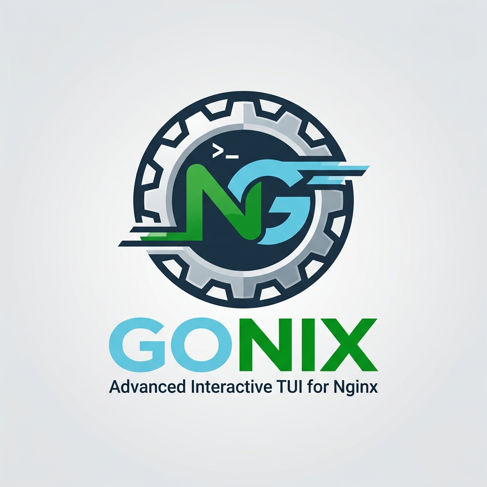

# GoNix - گونیکس

[](https://github.com/mrmmg/gonix/releases/latest)
[](https://github.com/mrmmg/gonix/releases)
[](LICENSE)
[](go.mod)

*[English](README.md)* · **[مستندات](https://mrmmg.github.io/gonix/fa/)**

**GoNix** یعنی **Go** + **Nginx**؛ یک **رابط ترمینالی تعاملی برای مدیریت Nginx** روی لینوکس که با Go نوشته شده.

ایده‌اش را از [Nginx Proxy Manager](https://nginxproxymanager.com/) گرفته‌ایم، ولی به‌جای اینکه Nginx را پشت یک دیتابیس و یک فرمت
اختصاصی پنهان کنیم، گونیکس یک لایه‌ی نازک و امن است که **روی** همان فایل‌های واقعی و قابل ویرایش Nginx می‌نشیند. هر تغییر
پشتیبان‌گیری می‌شود، با `nginx -t` آزموده می‌شود و اگر تست رد شود خودکار برمی‌گردد؛ پس Nginx هرگز خراب نمی‌ماند.
همین کارها به‌شکل دستور (برای اسکریپت) و برای عامل‌های هوش مصنوعی هم در دسترس است.

<p align="center">

https://github.com/user-attachments/assets/45f5a47a-ebe0-4b5c-a6c1-e2c971aaa8d5

</p>

## نصب

```bash
curl -fsSL https://raw.githubusercontent.com/mrmmg/gonix/main/install.sh | bash
sudo gonix
```

لینوکس، معماری amd64 یا arm64. اجرای دوباره‌ی نصب‌کننده، گونیکس را به‌روز می‌کند و به پیکربندی شما در `/etc/gonix` دست نمی‌زند.

## یک نمونه

```bash
sudo gonix host add app.example.com --upstream http://127.0.0.1:3000 --ssl app.example.com --presets security-headers,hsts
sudo gonix host set app.example.com --ip-list office --dry-run   # فقط diff را نشان بده، چیزی را عوض نکن
sudo gonix logs app.example.com --filter "status:5xx" --summary
sudo gonix check
```

## مستندات

بقیه‌ی مطالب در مستندات، به فارسی و انگلیسی، هست: **<https://mrmmg.github.io/gonix/fa/>**

- [امکانات](https://mrmmg.github.io/gonix/fa/docs/features/): همه‌ی کارهایی که گونیکس می‌کند
- [شروع سریع](https://mrmmg.github.io/gonix/fa/docs/quickstart/): اولین سایت HTTPS شما در پنج دقیقه
- [خط فرمان](https://mrmmg.github.io/gonix/fa/docs/cli/)، [عامل‌های هوش مصنوعی](https://mrmmg.github.io/gonix/fa/docs/ai-agents/) و [مرجع پیکربندی](https://mrmmg.github.io/gonix/fa/docs/configuration/)
- [مشارکت در پروژه](https://mrmmg.github.io/gonix/fa/docs/contributing/): ساخت از سورس، تست‌ها و ساختار پروژه

سورس مستندات در پوشه‌ی [`docs/`](docs/) است.

## Star History

<picture>
  <source media="(prefers-color-scheme: dark)" srcset="https://api.star-history.com/svg?repos=mrmmg/gonix&type=Date&theme=dark" />
  
</picture>

## مجوز

GoNix با [مجوز MIT](LICENSE) منتشر شده است.
