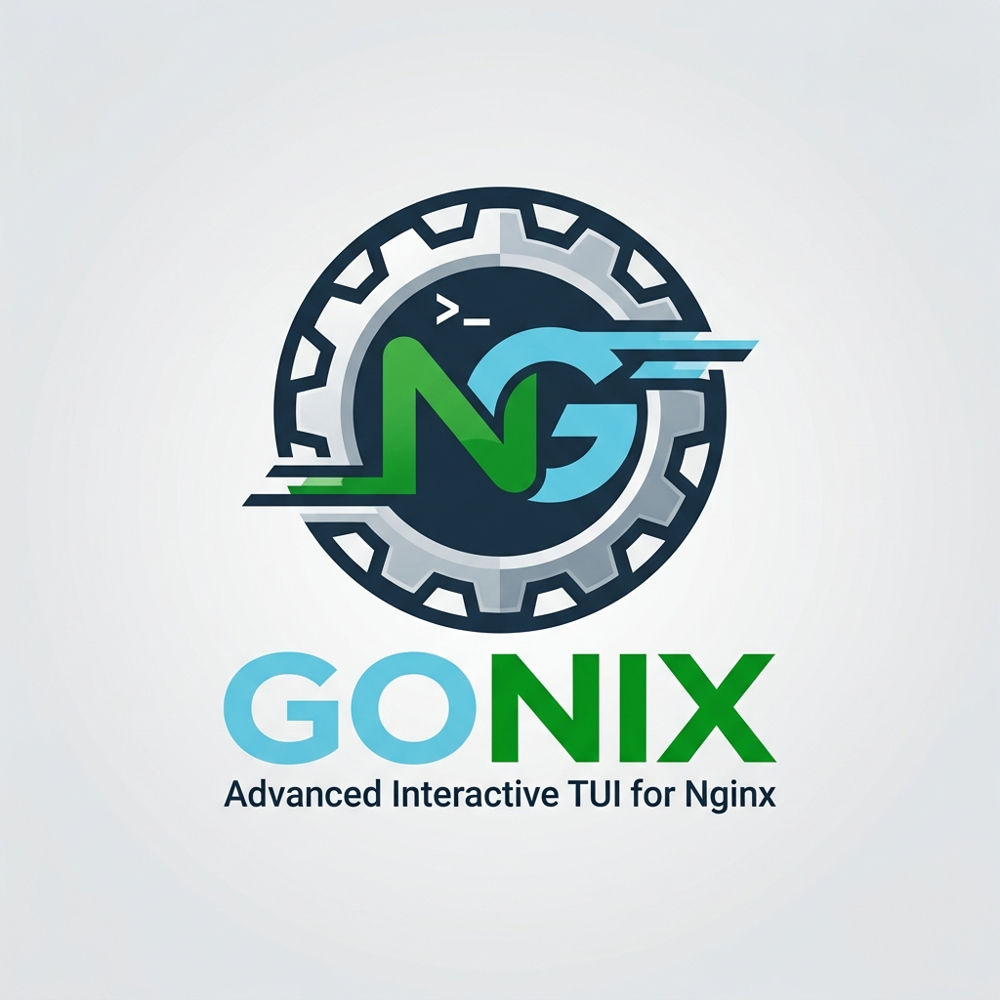

# GoNix

[](https://github.com/mrmmg/gonix/releases/latest)
[](https://github.com/mrmmg/gonix/releases)
[](LICENSE)
[](go.mod)

*[فارسی](README-fa.md)* · **[Documentation](https://mrmmg.github.io/gonix/)**

**GoNix** (**Go** + **Nginx**) is an interactive **terminal UI for managing Nginx** on Linux, written in Go.

It is inspired by [Nginx Proxy Manager](https://nginxproxymanager.com/), but instead of hiding Nginx behind a
database and a proprietary format, GoNix is a thin, safe layer **on top of** your real, human-editable Nginx
files. Every change is backed up, tested with `nginx -t` and rolled back automatically if the test fails, so Nginx is
never left broken. The same actions are available as scriptable commands and for AI agents.

<p align="center">

https://github.com/user-attachments/assets/45f5a47a-ebe0-4b5c-a6c1-e2c971aaa8d5

</p>

## Install

```bash
curl -fsSL https://raw.githubusercontent.com/mrmmg/gonix/main/install.sh | bash
sudo gonix
```

Linux, amd64 or arm64. Running the installer again upgrades GoNix and never touches your configuration in `/etc/gonix`.

## A taste

```bash
sudo gonix host add app.example.com --upstream http://127.0.0.1:3000 --ssl app.example.com --presets security-headers,hsts
sudo gonix host set app.example.com --ip-list office --dry-run   # show the diff, change nothing
sudo gonix logs app.example.com --filter "status:5xx" --summary
sudo gonix check
```

## Documentation

Everything else lives in the documentation, in English and Persian: **<https://mrmmg.github.io/gonix/>**

- [Features](https://mrmmg.github.io/gonix/en/docs/features/): everything GoNix can do
- [Quickstart](https://mrmmg.github.io/gonix/en/docs/quickstart/): your first HTTPS site in five minutes
- [Command line](https://mrmmg.github.io/gonix/en/docs/cli/), [AI agents](https://mrmmg.github.io/gonix/en/docs/ai-agents/) and [configuration reference](https://mrmmg.github.io/gonix/en/docs/configuration/)
- [Contributing](https://mrmmg.github.io/gonix/en/docs/contributing/): build from source, tests, project structure

The documentation sources are in [`docs/`](docs/).

## Star History

<picture>
  <source media="(prefers-color-scheme: dark)" srcset="https://api.star-history.com/svg?repos=mrmmg/gonix&type=Date&theme=dark" />
  
</picture>

## License

GoNix is released under the [MIT License](LICENSE).
